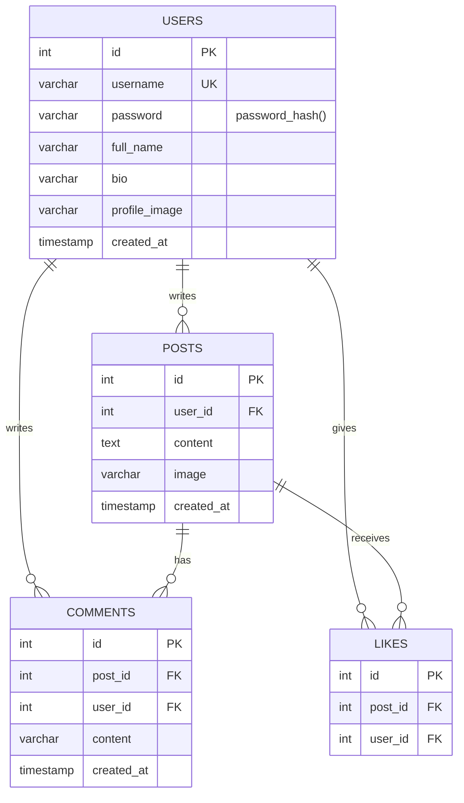

# Entity Relationship Diagram

Render this in GitHub, VS Code (Markdown Preview Mermaid), or https://mermaid.live
and export a PNG/PDF for your documentation.

`likes` has a UNIQUE key on (post_id, user_id) so a user can like a post only once.
All foreign keys use ON DELETE CASCADE.
